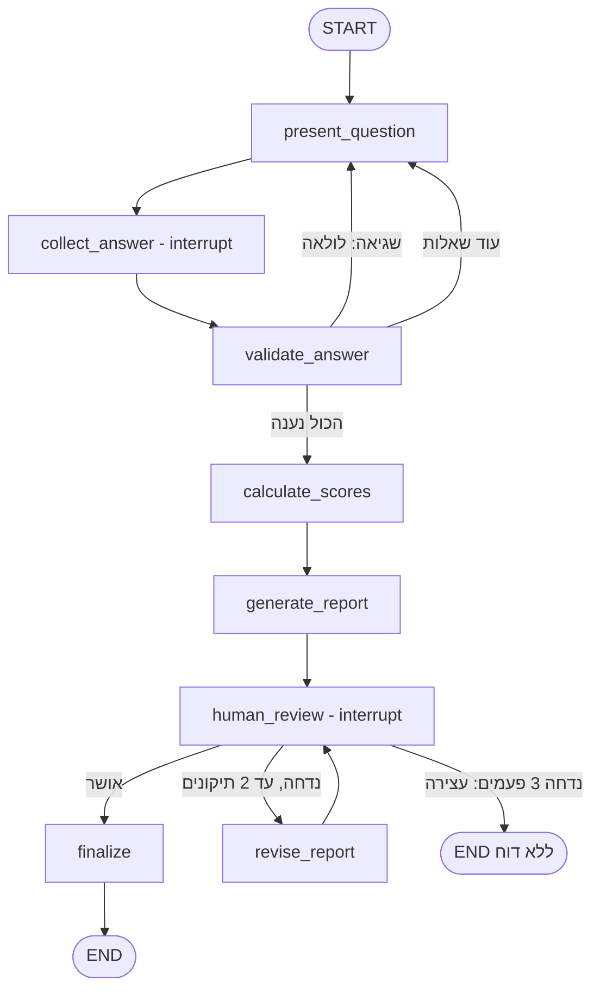
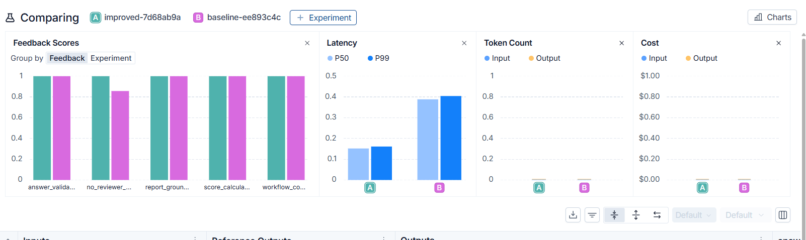
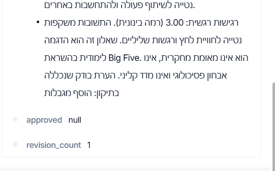
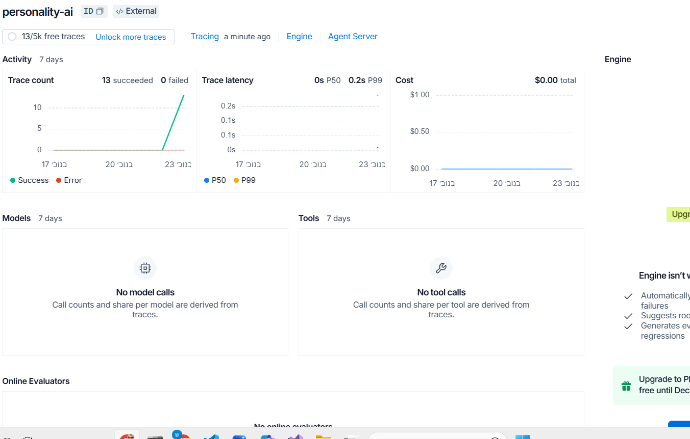
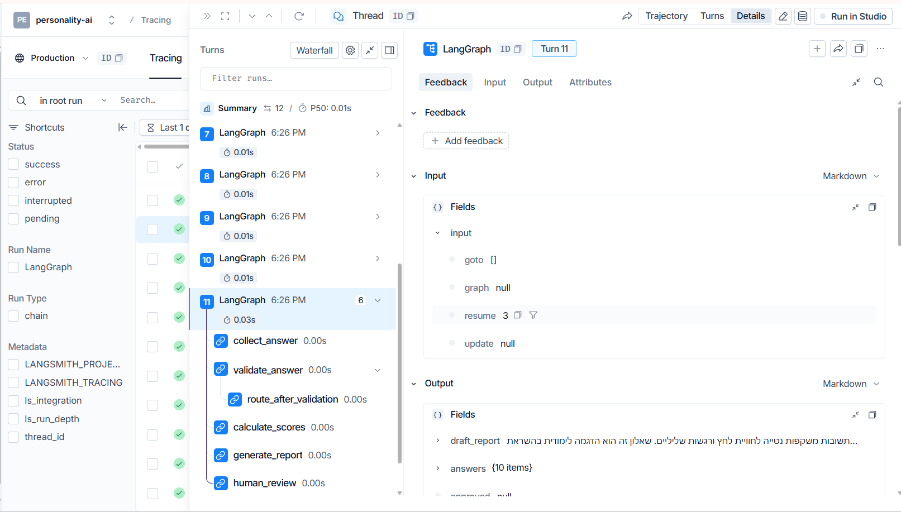

# personality-ai

סוכן LangGraph שמנהל שאלון הדגמה בהשראת Big Five, מחשב ציונים בקוד דטרמיניסטי, מנסח דוח, ועוצר לאישור בודק אנושי לפני הצגת הדוח הסופי.

## מטרה ומגבלות

- **זו הדגמה לימודית.** השאלון אינו מאומת מחקרית לעברית, אין לו מפתח ניקוד מאושר, והדוח אינו אבחון פסיכולוגי ואינו מדד קליני.
- הציונים מחושבים בפייתון בלבד. מודל שפה לא מחשב ציונים ולא קובע את הניתוב של הגרף.
- הדוח נכתב מתוך הציונים בלבד, ובתבנית קבועה או בניסוח של מודל שפה שעובר בדיקת נאמנות.
- הדאטהסט קטן (7 מקרים). הבודק `report_groundedness` הוא בדיקת טקסט פשוטה ולא הבנה של משמעות.

## השאלון

- מבוסס על פריטי **IPIP-50** (International Personality Item Pool), שהם נחלת הכלל. הפריטים מוגדרים ב-`src/questionnaire.json` עם מזהה יציב לכל פריט (I01 עד I50), תכונה אחת לכל פריט, וסימון היפוך.
- התרגום לעברית נעשה לצורך הפרויקט, ודורש בדיקה אנושית לפני שימוש רציני.
- ניקוד: ממוצע לכל תכונה על הסולם המקורי (1 עד 5). פריט הפוך מחושב כ-`min + max - ערך`. הסולם נלקח מהשאלון ולא מקוד קשיח.

## התקנה והרצה

```bat
python -m venv .venv
.venv\Scripts\activate
python -m pip install -r requirements.txt
```

משתני סביבה, בקובץ `.env` בתיקייה הראשית:

```env
LANGSMITH_TRACING=true
LANGSMITH_API_KEY=...
LANGSMITH_PROJECT=personality-ai
LLM_MODE=fake
```

`LLM_MODE=fake` מפעיל מודל דמה שלא פונה לשום שירות חיצוני. ערך אחר מפעיל את מודל השפה שהוגדר בפרויקט. הניסויים תמיד רצים עם `LLM_MODE=fake`, כדי שתוצאותיהם לא יושפעו מהמודל.

הרצה בטרמינל:

```bat
python -m src.cli
```

הרצה כאתר (בדפדפן, בלי טרמינל):

```bat
python -m src.server
```

ואז פותחים בדפדפן את הכתובת `http://127.0.0.1:5000`. חשוב לפתוח דרך הכתובת הזו ולא לפתוח את קובץ ה-HTML ישירות, כי אחרת הדפדפן חוסם את הבקשות לשרת.

הרצת הבדיקות האוטומטיות:

```bat
python -m pytest -v
```

## גרף LangGraph



### ענפים ולולאות
- **לולאת שאלה:** תשובה לא תקינה חוזרת לאותה שאלה.
- **ענף אחרי ולידציה:** תשובות שנענו ← חישוב. אחרת ← שאלה הבאה.
- **לולאת תיקון:** דחייה מחזירה לתיקון ולבדיקה חוזרת, עד `MAX_REVISIONS = 2`. אחרי כן הגרף עוצר בלי דוח סופי, כדי למנוע לולאה אינסופית.

### שתי העצירות (Human-in-the-loop)
1. **`collect_answer`:** הגרף עוצר ומחכה לתשובת הנבדק. ולידציה כושלת לא מגיעה לבודק.
2. **`human_review`:** הגרף עוצר ומחכה להחלטת הבודק: `approved` והערות אופציונליות.

העצירות ממומשות ב-`interrupt` עם checkpointer (`MemorySaver`), וממשיכים עם `Command(resume=...)`.

## תפקידים
- **הנבדק:** עונה על השאלות, ומשלים תשובה חסרה או לא תקינה.
- **סוכן ה-AI:** מציג שאלות מהמאגר הקבוע, מאמת תשובות, מחשב ציונים, מנסח טיוטת דוח.
- **הבודק האנושי:** מאשר או דוחה את הטיוטה, ומוסיף הערות אם רוצה. הוא לא מטפל בתשובות חסרות.

## LangSmith: דאטהסט ובודקים

**דאטהסט:** `personality-ai-v4`, 7 מקרים (נוצר מ-`evaluation/create_dataset.py`):
`valid_all_threes`, `missing_answer`, `out_of_range`, `non_numeric`, `reverse_coded`, `reject_then_approve`, `three_rejections_stop`.

**בודקים** (`evaluation/evaluators.py`), כולם בדיקות דטרמיניסטיות בפייתון:
- `answer_validation_accuracy`: מספר השגיאות שזוהו זהה לצפוי.
- `score_calculation_accuracy`: כל ציון זהה לציון הייחוס.
- `workflow_completion`: הגרף הגיע לסיום הנכון, עם מספר התיקונים הצפוי.
- `report_groundedness`: כל ציון מופיע בדוח, המגבלות מופיעות, ואין ניסוחים אסורים.
- `no_reviewer_note_in_final`: הערת הבודק לא נכנסת לדוח הסופי.

## ניסויים

```bat
set LLM_MODE=fake
python -m evaluation.run_experiment baseline
python -m evaluation.run_experiment improved
python -m evaluation.compare_experiments evaluation\results_baseline.csv evaluation\results_improved.csv
```

### השיפור
**השינוי:** `revise_report` בונה מחדש את הדוח מהציונים בלבד, בלי להכניס את הערת הבודק לטקסט שמוצג לנבדק. ההערה נשארת ב-State.

**מגבלה:** התבנית הדטרמיניסטית לא מפרשת טקסט חופשי, לכן ההערה לא משנה את הדוח. זה תיקון של הכשל שנמצא, ולא שילוב מלא של הערות הבודק. שכתוב לפי הערות דורש מודל שפה לניסוח, וזה נשאר להמשך.

### תוצאות (דאטהסט `personality-ai-v4`, מתוך הקבצים שיוצאו מ-LangSmith)

| בודק | לפני (baseline) | אחרי (improved) |
|---|---|---|
| answer_validation_accuracy | 1.00 | 1.00 |
| score_calculation_accuracy | 1.00 | 1.00 |
| workflow_completion | 1.00 | 1.00 |
| report_groundedness | 1.00 | 1.00 |
| no_reviewer_note_in_final | 0.86 | 1.00 |



**השיפור:** בגרסה הישנה, בתהליך של דחייה ואז אישור, הערת הבודק נכנסה לדוח הסופי. הבדיקה `no_reviewer_note_in_final` תפסה את זה (0.00 באותו מקרה). התיקון מונע את ההכנסה, והציון עלה ל-1.00.



### תובנה אחת מה-traces
`report_groundedness` נשאר 1.00 גם בגרסה הישנה, למרות ההדלפה. הבודק הזה בודק שהציונים והתיאורים נמצאים בדוח, ולא שאין בו תוכן אסור. רק בדיקה ייעודית לתוכן האסור תפסה את הבעיה. מסקנה: בדיקת נאמנות כללית לא מספיקה כדי לבדוק מה לא צריך להופיע בדוח, ולכן צריך בודק נפרד לכל מה שאסור.

## הגבלות
- 7 מקרים בלבד, ריצה אחת לכל ניסוי.
- הניסויים רצו עם `LLM_MODE=fake`, כלומר בלי מודל שפה. הדוח נכתב מתבנית.
- הבודק `no_reviewer_note_in_final` נוסף **אחרי** הריצה הראשונה. כדי שלא ייראה כמדד שנבחר לפי התוצאות, הוא נכתב בצורה מפורשת ומתועד כאן.
- ריצות מוקדמות יותר, שבהן מונה הדחיות לא התעדכן או שהדאטהסט היה שגוי (`v1`, `v2`, `v3`), לא נכללות בתוצאות.
- התרגום העברי של 50 הפריטים נעשה על ידי מי שכתב את הקוד, ודורש בדיקה אנושית לפני הגשה.
- ציון 1.00 על 7 מקרים לא מוכיח שהמערכת נכונה בכל המצבים.

## צילומי מסך (LangSmith)

**מסך הפרויקט:** הפרויקט `personality-ai` עם מספר ה-traces שנרשמו.



**ריצה אחת של הגרף:** הצמתים לפי הסדר, כולל העצירה ב-`human_review`.



## מצב השלמה
- [x] LangGraph עם ענף מותנה ולולאה
- [x] שתי עצירות interrupt עם חידוש
- [x] דאטהסט ב-LangSmith
- [x] בודקים אוטומטיים
- [x] שני ניסויים על אותו דאטהסט, עם תוצאות מתועדות
- [x] צילומי מסך מ-LangSmith
- [x] תובנה מה-traces
- [ ] בדיקה אנושית של התרגום לעברית
- [ ] ערוץ מודל שפה לניסוח הדוח (ספק חדש, לפי ההגדרות ב-`.env`)
