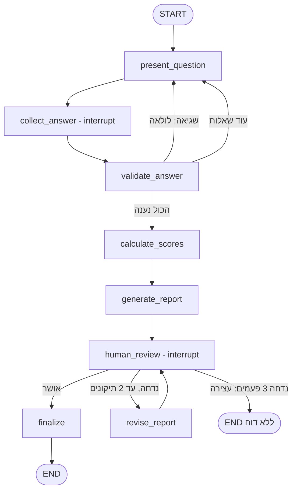

# personality-ai

סוכן LangGraph שמנהל שאלון הדגמה בהשראת Big Five, מחשב ציונים בקוד דטרמיניסטי, מנסח דוח, ועוצר לאישור בודק אנושי לפני הצגת הדוח הסופי.

## מטרה ומגבלות

- **זו הדגמה לימודית.** השאלון אינו מאומת מחקרית, אין לו מפתח ניקוד מאושר ואין לו רישיון שימוש. הדוח אינו אבחון פסיכולוגי ואינו מדד קליני.
- הציונים מחושבים בפייתון בלבד. מודל שפה לא מחשב ציונים.
- הדוח נכתב בתבנית קבועה, מתוך הציונים בלבד.
- הדאטהסט קטן (7 מקרים). הבודק `report_groundedness` הוא בדיקת טקסט פשוטה ולא הבנה של משמעות.

## התקנה והרצה

```bat
python -m venv .venv
.venv\Scripts\activate
python -m pip install -r requirements.txt
```

משתני סביבה, בקובץ `.env` בתיקייה הראשית (ראו `.env.example`):

```env
LANGSMITH_TRACING=true
LANGSMITH_API_KEY=...
LANGSMITH_PROJECT=personality-ai
```

הרצת הבדיקה האינטראקטיבית:

```bat
python -m src.cli
```

הרצת הבדיקות האוטומטיות:

```bat
python -m pytest -v
```

## גרף LangGraph



### ענפים ולולאות
- **לולאת שאלה:** תשובה לא תקינה חוזרת לאותה שאלה.
- **ענף אחרי ולידציה:** תשובות שנענו ← חישוב; אחרת ← שאלה הבאה.
- **לולאת תיקון:** דחייה מחזירה לתיקון ולבודק שוב, עד `MAX_REVISIONS = 2`. אחרי כן הגרף עוצר בלי דוח סופי, כדי למנוע לולאה אינסופית.

### שתי העצירות (Human-in-the-loop)
1. **`collect_answer`:** הגרף עוצר ומחכה לתשובת הנבדק. ולידציה כושלת לא מגיעה לבודק.
2. **`human_review`:** הגרף עוצר ומחכה להחלטת הבודק: `approved` והערות אופציונליות.

העצירות ממומשות ב-`interrupt` עם checkpointer (`MemorySaver`), וממשיכים עם `Command(resume=...)`.

## תפקידים
- **הנבדק:** עונה על השאלות, ומשלים תשובה חסרה או לא תקינה.
- **סוכן ה-AI:** מציג שאלות מהמאגר הקבוע, מאמת תשובות, מחשב ציונים, מנסח טיוטת דוח.
- **הבודק האנושי:** מאשר או דוחה את הטיוטה. הוא לא מטפל בתשובות חסרות.

## השאלון ומפתח הניקוד
- מקור: שאלון **דמו** שנכתב לפרויקט, בהשראת Big Five. מוגדר ב-`src/questionnaire.json` עם מזהה יציב לכל פריט, תכונה אחת לכל פריט, וסימון היפוך.
- ניקוד: ממוצע לכל תכונה על הסולם המקורי. פריט הפוך מחושב כ-`min + max - ערך`, והסולם נלקח מהשאלון ולא מקוד קשיח.

## LangSmith: דאטהסט ובודקים

**דאטהסט:** `personality-ai-v2`, 7 מקרים (נוצר מ-`evaluation/dataset.json` עם `python -m evaluation.create_dataset`):
`valid_all_threes`, `missing_answer`, `out_of_range`, `non_numeric`, `reverse_coded`, `reject_then_approve`, `three_rejections_stop`.

**בודקים** (`evaluation/evaluators.py`):
- `answer_validation_accuracy`: מספר השגיאות שזוהו זהה לצפוי.
- `score_calculation_accuracy`: כל ציון זהה לציון הייחוס.
- `workflow_completion`: הגרף הגיע לסיום הנכון, עם מספר התיקונים הצפוי.
- `report_groundedness`: כל ציון מופיע בדוח, המגבלות מופיעות, ואין ניסוחים אסורים.
- `no_reviewer_note_in_final`: הערת הבודק לא נכנסת לדוח הסופי.

## ניסויים

```bat
python -m evaluation.run_experiment baseline
python -m evaluation.run_experiment improved
python -m evaluation.compare_experiments evaluation\results_baseline.csv evaluation\results_improved.csv
```

### השיפור
**השינוי:** `revise_report` בונה מחדש את הדוח רק מהציונים, בלי להכניס את הערת הבודק לטקסט שמוצג לנבדק. ההערה נשארת ב-State.

**מגבלה:** התבנית הדטרמיניסטית לא מפרשת טקסט חופשי, לכן ההערה לא משנה את הדוח. זה תיקון של הכשל שנמצא, ולא שילוב מלא של הערות הבודק. שכתוב לפי הערות דורש מודל שפה לניסוח, וזה נשאר להמשך.

### תוצאות (מתוך הקבצים שיוצאו מ-LangSmith)

| בודק | לפני (baseline) | אחרי (improved) |
|---|---|---|
| answer_validation_accuracy | 1.00 | 1.00 |
| score_calculation_accuracy | 1.00 | 1.00 |
| workflow_completion | 1.00 | 1.00 |
| report_groundedness | 1.00 | 1.00 |
| no_reviewer_note_in_final | 0.86 | 1.00 |

**הערות על המדידה, לשקיפות:**
- הבודק `no_reviewer_note_in_final` נוסף **אחרי** שראינו את התוצאות הראשונות של הניסוי. לכן ההשוואה מודדת את הכשל שהתגלה, ולא מדד שהוגדר מראש.
- ניסוי הבסיס הראשון על הדאטהסט `personality-ai-v1` נכשל בגלל באג בתשתית הבדיקה: ערך `None` כ-`resume` גורם לקריסה ב-LangGraph. תוקן על ידי ייצוג תשובה חסרה כמחרוזת ריקה, ועל ידי דאטהסט חדש (`v2`). שני הניסויים לפני ואחרי רצים על `v2`.
- הדאטהסט קטן, ולכן ציון 1.00 לא מוכיח שהמערכת נכונה בכל המצבים.

## צילומי מסך (LangSmith)
- `screenshots/trace_project.png`: הפרויקט `personality-ai` עם מספר ה-traces.
- `screenshots/trace_run.png`: ריצה אחת פתוחה, עם הצמתים לפי הסדר.
- `screenshots/PENDING_compare.png`: השוואת הניסויים `baseline` ו-`improved` (לצלם לפני הגשה).
screenshots/trace_revise_node.png ו-screenshots/trace_revise_leak.png.

## תובנה אחת מה-traces
בניסוי הבסיס, במקרה reject_then_approve, הצומת revise_report הכניס את הערת הבודק ("הוסף מגבלות") לתוך טיוטת הדוח, כפי שמופיע בשדה ה-Output של הצומת ב-trace (ראו screenshots/trace_revise_leak.png). כלומר, טקסט פנימי שמיועד לבודק הגיע לדוח שהנבדק היה רואה. הבודק report_groundedness לא זיהה את הבעיה, כי הוא בודק רק שהציונים והמגבלות מופיעים בדוח, ולא מי כתב כל טקסט בו. רק הבודק no_reviewer_note_in_final תפס את הכשל (0.00 במקרה הזה). השיפור, שמשאיר את ההערה מחוץ לדוח, העלה את הבודק הזה ל-1.00. מכאן שה-trace חשף את מקור הכשל, והבודקים האוטומטיים סימנו אותו.

## מצב השלמה
- [x] LangGraph עם ענף מותנה ולולאה
- [x] שתי עצירות interrupt עם חידוש
- [x] דאטהסט ב-LangSmith
- [x] בודקים אוטומטיים
- [x] שני ניסויים על אותו דאטהסט, עם תוצאות מתועדות
- [X] צילומי מסך נוספים (השוואה)
- [x] תובנה מה-traces (ממתין לבדיקה)
